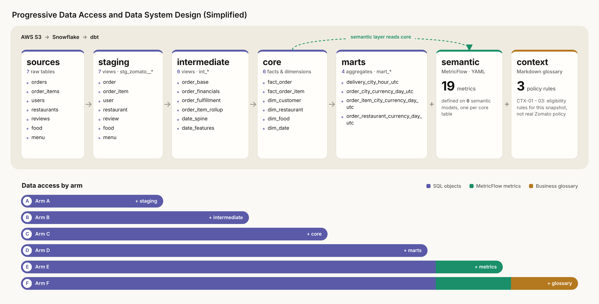
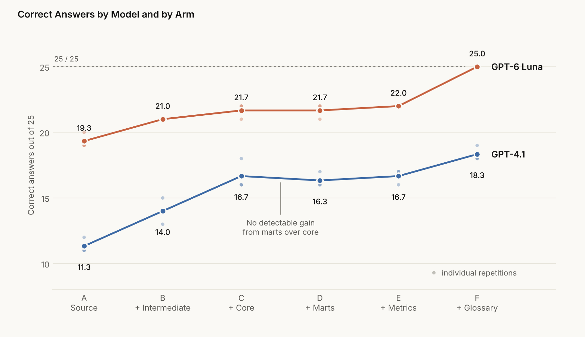
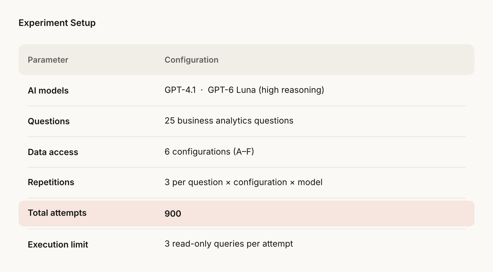
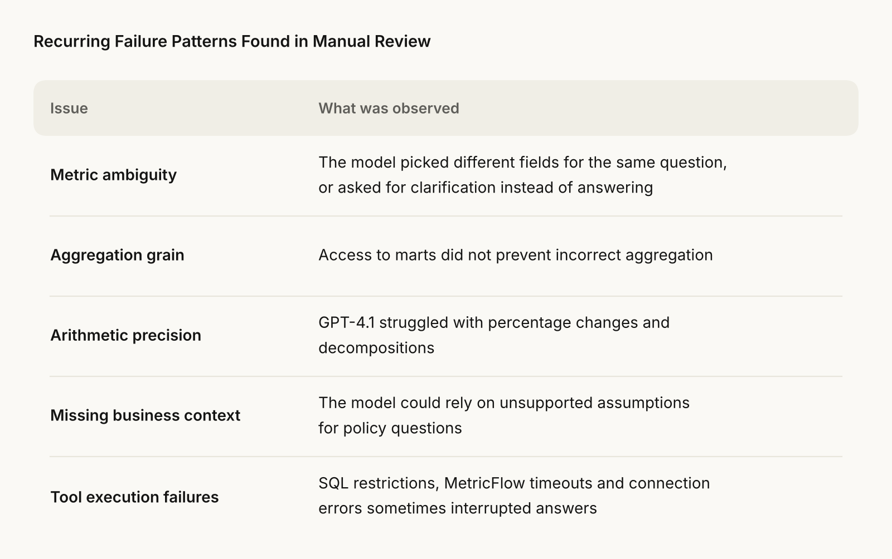

# Does better data modelling improve AI analytics?

> A controlled experiment: give an LLM progressively richer data layers (source → staging → intermediate → core → marts → metrics → glossary) and measure how answer correctness changes.

Companion repo for the Medium article [*Does better data modelling actually improve AI analytics?*](https://medium.com/@achmad.rozie/does-better-data-modelling-actually-improve-ai-analytics-7e3894d1e244). Builds on [`zomato-ai-analytics-pipeline`](https://github.com/achmadrozie/zomato-ai-analytics-pipeline).

[](assets/diagram_data_system.png)

## Problem

Teams invest in staging, core models and semantic layers, but it is rarely measured whether an AI analyst answers better because of them. This repo tests that: same questions, same models, only the data access changes.

## Headline result

Mean correct answers out of 25 (3 repetitions each):

| Model | A: source/staging | F: all layers + glossary |
|---|---|---|
| GPT-4.1 | 11.3 | 18.3 |
| GPT-6 Luna (high reasoning) | 19.3 | 25.0 |

[](assets/fig1_correctness.png)

- Most of the gain comes from the intermediate and core layers, plus the glossary. Marts and metrics add no detectable gain over core.
- The glossary is what makes the three policy questions (Q22–Q24) answerable, by construction: arms A–E score 0 there.
- Cost is not monotonic. Richer context raises cost per correct answer by ~1.2× for both models by arm F, except GPT-4.1 on core, where it is cheaper (0.83×).

## Experiment design

[](assets/table1_experiment_setup.png)

- 25 business questions, 6 access arms (A–F), 2 models, 3 repetitions = 900 attempts.
- Each attempt may run up to 3 read-only queries. The model never sees reference answers.
- Grading is deterministic ([`scripts/autograde.py`](scripts/autograde.py)) against [reference answers](experiments/answers_25.md).
- Details: [`docs/experiment_design.md`](docs/experiment_design.md). Scoring and reproduction: [`experiments/README.md`](experiments/README.md).

## What the models got wrong

[](assets/table7_failure_patterns.png)

Full numbers, including cost and latency by arm: [`docs/RESULTS.md`](docs/RESULTS.md) (generated by `scripts/build_results.py`). Three diagnostic [follow-up tasks](docs/experiment_extension_questions.md) go beyond the frozen benchmark.

## Repository map

| Path | Contents |
|---|---|
| `aws/`, `snowflake/` | S3 loading and Snowflake setup. `snowflake/project1/` creates `ZOMATO_DLR` |
| `dbt_zomato/` | 7 staging, 6 intermediate, 6 core models; 4 marts; 6 semantic models; 19 metrics |
| `context/` | Versioned Markdown business glossary (CTX-01–03, synthetic policy rules) |
| `experiments/` | Questions, reference answers, graded results |
| `scripts/` | Experiment runner, autograder, results builder |
| `docs/` | Design, results, extension tasks |
| `archive/project0/` | Superseded Project 0 mart |

Each dbt model has its own folder with matching `.sql`, `.md` and `.yml` files (logic, grain, tests).

## Getting started

```bash
export DBT_SNOWFLAKE_ACCOUNT=... DBT_SNOWFLAKE_USER=... DBT_ENV_SECRET_SNOWFLAKE_PASSWORD=...
cp dbt_zomato/profiles.yml.example .local/dbt/profiles.yml
# run snowflake/project1/01_initialize.sql once, then:
dbt build --profiles-dir .local/dbt --project-dir dbt_zomato
```

The profile and run guard require `ZOMATO_DLR`, so this project cannot write to the Project 0 `ZOMATO` database. `01_initialize.sql` copies `USERS` without `PASSWORD` and preserves the first snapshot on re-run.

## Tech stack

AWS S3 · Snowflake · dbt Core · MetricFlow · OpenAI (GPT-4.1, GPT-6 Luna) · Python

## Limits

- One dataset, one domain, two models, 3 repetitions: directional evidence, not a general claim.
- Glossary policy rules are written for this snapshot, not real Zomato policy.
- Cost figures are estimates from token usage.

**Achmad Rozie** · [GitHub](https://github.com/achmadrozie)
